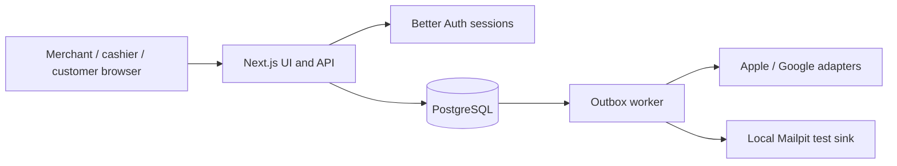

# Architecture and security notes

LoopLocal is one TypeScript/Next.js application backed by PostgreSQL. Drizzle owns domain migrations; Better Auth manages password login and database sessions. A separate small worker polls PostgreSQL outbox rows. Docker Compose supplies only local PostgreSQL and Mailpit. `npm run local` starts the local stack after `.env` setup; [RUNBOOK.md](RUNBOOK.md) gives the exact command and safeguards.

The cashier QR contains a random `scanCode`. The card URL uses a distinct random bearer `cardToken` for customer viewing and preferences. Neither QR nor cashier lookup returns email or a trusted balance. The server checks session, active tenant role and location, then reads the membership balance in PostgreSQL. A scan identifies a card; only an explicit award/redeem request changes value.

Award, redemption and reasoned correction lock the membership row, validate role and limits, write an immutable ledger row and update the integer cached balance within one transaction. Redemption also snapshots the reward version; a unique tenant/idempotency key prevents duplicate requests. A database trigger rejects ledger UPDATE/DELETE. The same transaction queues wallet refresh. Thus a wallet outage can leave a job blocked without undoing a committed loyalty transaction. The worker uses row locking, bounded retries, leases and controlled replay. Wallet balances remain display copies.

Tenant and location IDs are linked with composite foreign keys in domain tables. Owner, manager and cashier checks run in server functions. Owners can edit a programme, invite/revoke staff and export merchant data; managers have scoped reports/checkout; cashiers can look up and transact only at their location. Revocation blocks later operations through the active-role query. JSON endpoints validate inputs and mutation routes check request origin. Uploaded logos are restricted by type, content signature and size.

The merchant dashboard reports enrolled cards and counts of award/redemption events since programme start, plus 10 recent entries. These are operational counts, not measured visits, incremental sales or attributed revenue. Points are explicit integers entered at checkout; purchase-amount conversion/rounding is not implemented. A merchant can currently have one active programme per location, while the UI creates the first location only.

**Residual risks:** the card URL is a bearer recovery credential and can be shared or captured; production reverse-proxy/access logs must redact card-token paths. Screenshots/QR copies can identify the same membership at checkout. There is no claim of fraud-proof static codes. Optional enrollment email is not ownership-verified, so recovery/marketing operations require further work. Rate limiting outside the demo form is incomplete. The local email worker is constrained to verified synthetic `.test` recipients and local Mailpit; external delivery is disabled. Legal pages, deletion and retention workflows remain launch work. See [LAUNCH_BLOCKERS.md](LAUNCH_BLOCKERS.md).
